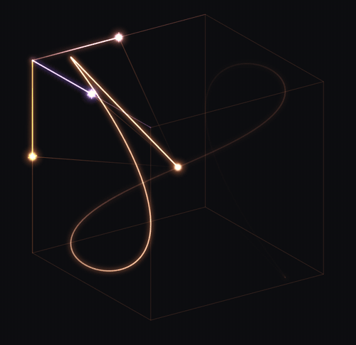

<div align="center">


# oscilla

**A 3D Lissajous figure drawn like an analog oscilloscope - and you can hear it.**




</div>

## What it is

Three bodies swing back and forth, one along each axis - x, y and z - each on its own rail.
A fourth point takes its x from the first, its y from the second and its z from the third,
and traces a Lissajous curve through the box they span.
The whole thing glows like phosphor on a CRT: fast passes are faint, slow turns burn bright,
and every line fades the way a real beam does.

Each body also ticks with its own ring every time it crosses the center of its rail.
Speed it up and the ticks fuse into a tone pitched by how fast they come, like a card in bicycle spokes,
and the three bodies into a chord whose intervals are their frequency ratios - you hear the shape, not just watch it.

## Features

- **Phosphor beam** - brightness comes from the energy the beam leaves on each pixel, decays exponentially and saturates smoothly instead of clipping
- **Live retuning** - change any axis frequency on the fly; the phase stays continuous, so the figure morphs instead of jumping
- **Closed trail** - the full figure is traced once per period, `1 / gcd(fx, fy, fz)`, then held
- **Orbit camera** - drag anywhere to turn the scene, wheel or pinch to zoom; the box, rails and trail turn with it
- **Speed control** - logarithmic slider from `0.01x` to `200x`, independent of the frequencies
- **Sample-accurate sound** - ticks are generated in an `AudioWorklet` from the same clock as the picture, so each one lands as its body crosses the center
- **Stays in sync** - a hidden tab freezes scene time, so picture and sound never drift apart

## Controls

| Control | What it does |
| --- | --- |
| `trail` | Show or hide the traced figure |
| `sound` | Mute or unmute the ticks (audio starts after your first click, tap or key press - a browser rule) |
| `x` `y` `z` | Frequency of each axis, in Hz; whole-number ratios give closed figures |
| `speed` | How fast scene time runs relative to real time |
| Drag | Rotate the camera |
| Wheel / pinch | Zoom |

Try `3 : 2 : 6`, `1 : 2 : 3` or `3 : 4 : 5` for a start.

## How it works

**Motion.** Every body is a sine oscillator: `position = center + A * sin(2 * pi * (f * t + phase))`.
Retuning recomputes `phase` at the current moment, so the body keeps its place and only its pace changes.

**Light.** The marker beam is drawn in short bands on a fixed time grid.
Each band gets brightness proportional to the real time the beam spent per pixel, times
an exponential decay by age. Because the motion is periodic, every older lap folds into one
closed-form factor `1 / (1 - exp(-period / decay))`, so the glow costs one period of drawing.
The rails of the three bodies are solved exactly per point and painted as a single gradient.
Halos go to a separate layer that shares one blur pass - the bloom.

**Sound.** A small `AudioWorklet` counts center crossings - two per cycle - and strikes at each one,
split across two samples so its timing is not snapped to the sample grid. A strike is a smoothed thump
plus a short ring at the ball's own resonance (x, y and z form an A major triad), and its sign follows the
direction the ball crosses in. Past about 20 ticks per second they fuse into a tone at `f * speed`,
so the three balls play a chord with the intervals of their frequency ratios: `2 : 3 : 4` is a root,
its fifth and its octave. The ring fades out as ticks fuse so it does not whistle, and the level eases
down with the tick rate so faster motion does not get louder.

## Run it

```bash
npm install
npm run dev
```

Then open the URL Vite prints.

```bash
npm run build     # type-check the app and the worklet, then bundle into dist/
npm run preview   # serve the production build locally
```

## Project layout

```
src/
  main.ts           wiring: scene, clock, renderer, trail, sound, controls
  scene.ts          the three oscillators and their default frequencies
  oscillation.ts    sine motion of a single body
  phase.ts          phase math shared with the audio worklet
  lissajous.ts      combined point, bounding box, period and sampling step
  clock.ts          scene time, speed and pause
  camera.ts         orbit projection, drag to rotate, wheel and pinch to zoom
  render.ts         phosphor beam, rails, bloom
  trail.ts          one-period trail on its own canvas
  sound.ts          audio graph and clock-to-audio-time sync
  worklets/         the click generator running on the audio thread
  theme.ts          palette, shared with the CSS controls
  controls.ts       toggles, frequency inputs, speed slider
deploy/
  oscilla.nginx     static site config with long-lived asset caching
```

## Deploy

Every push to `main` builds the site in GitHub Actions and syncs `dist/` to the server over `rsync`
(see `.github/workflows/deploy.yml`). It needs `DEPLOY_HOST`, `DEPLOY_USER` and `DEPLOY_SSH_KEY`
as repository secrets, and nginx on the server configured with `deploy/oscilla.nginx`.
